<div align="center">

# 🏁 Lights Out

### Relive every race in 3D. Follow live timing. Simulate any era. Free for every fan.

**A free, open-source race companion for Formula 1 fans: 3D race replays on real circuits, free live timing, a physics race simulator from 1950 to today, a strategy lab, and a 4K HDR multiview player for your own F1 TV subscription. Built by fans, for fans.**

[](LICENSE)


[](#-contributing)


[Trailer](#-the-trailer) · [Why Lights Out](#%EF%B8%8F-why-lights-out) · [Tour](#-a-tour-of-lights-out) · [Quick start](#-quick-start) · [Desktop app](#%EF%B8%8F-desktop-app-and-executable) · [F1 TV](#-f1-tv) · [Controls](#%EF%B8%8F-controls) · [API](#-api) · [Contributing](#-contributing) · [License](#-license)

<br>

### 🎬 The trailer

https://github.com/user-attachments/assets/437018d1-d11f-4200-82bf-0fa081b1e8d3

<sub><b>▶ 22 seconds, sound on.</b> Five lights, then: replay every race in 3D, simulate any era, stream 4K HDR multiview. · <a href="docs/media/lights-out-trailer.mp4">Download (mp4)</a> · <a href="docs/media/lights-out-trailer.jpg">poster</a></sub>

<br><br>

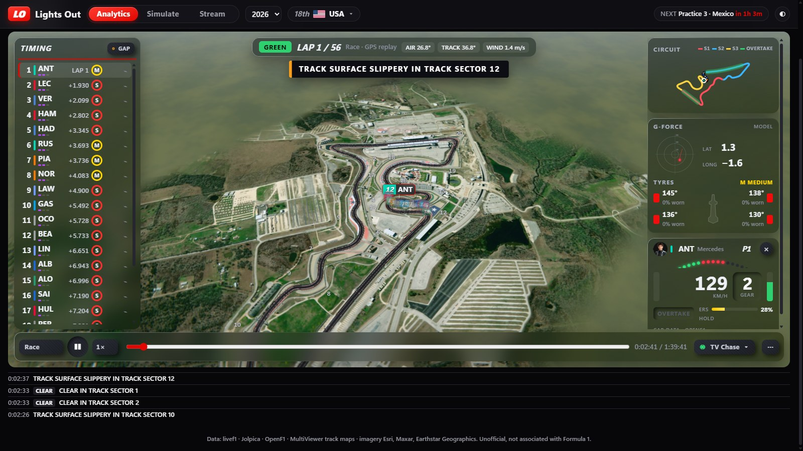

<sub>The 2026 United States Grand Prix, replayed from real GPS on a satellite-mapped Circuit of the Americas.</sub>

</div>

---

## 💚 Free and open, for everyone

Lights Out is a **community project**. It is free to download, free to use and free to change, and it always will be.

<table>
<tr>
<td width="33%" valign="top">

**🆓 Free, with nothing held back**<br>
No paywall, no premium tier, no "pro" features, no trial. Every feature in this README is in the free app, because the free app is the only app.

</td>
<td width="33%" valign="top">

**🔓 Open source (MIT)**<br>
Every line is here to read, learn from, fork and improve. Use it, run it for your friends, build on it: the [MIT license](LICENSE) lets you.

</td>
<td width="33%" valign="top">

**🙅 No ads, no accounts, no tracking**<br>
No sign-up, no ads, no cookies, no analytics service. It runs on your own computer, and the only usage numbers are anonymous daily totals that stay on your machine.

</td>
</tr>
<tr>
<td valign="top">

**🤝 Built by fans, for fans**<br>
Made in spare time out of love for the sport, and shaped by the people who use it. Ideas, bug reports and pull requests are all welcome.

</td>
<td valign="top">

**🌍 Open for all**<br>
Runs on any computer with Python, on your phone or tablet over your home network, or as a one-click Windows app. No GPU farm, no cloud bill, no gatekeeper.

</td>
<td valign="top">

**🏳️ Unofficial and independent**<br>
Lights Out is not associated with Formula 1, F1 TV, the FIA or any team. It uses open community data, and F1 TV only through your own subscription. [More below](#%EF%B8%8F-disclaimer).

</td>
</tr>
</table>

## 🏎️ Why Lights Out

Watching a race tells you what happened. Lights Out lets you **look inside it**: ride onboard with the leader, see exactly where a pass was made, rerun the race with a different pit stop, or put a 1990s V10 on today's circuit and race it yourself.

| | |
|---|---|
| 🎬 **Every race since 1996 in 3D** | Real GPS for 2023+ (every car, every session), real lap timing back to 1996, on true-scale circuits with real elevation, banking and satellite ground |
| 🔴 **Live timing, free** | During a race weekend, follow the session as it happens: tower, gaps, tyres, race control and weather, no subscription needed |
| 🕹️ **A race simulator, 1950 to 2026** | A physics race on any circuit with any era's cars, driven by AI or by you on keyboard or gamepad |
| 🧪 **Strategy lab** | Move a driver's pit stops and see where they would have finished; let the lab try every plan |
| 📊 **Every number** | Results, lap charts, standings, driver careers, and every raw data table, filterable and exportable |
| 📺 **4K HDR F1 TV multiview** | With your own subscription: past races from 2025 on in 2160p50 HDR (live sessions in 1080p on Windows), every driver's onboard side by side, live data over the picture and transcribed team radio |
| 🖥️ **Runs anywhere** | Browser, other devices on your network, or a Windows desktop app. No build step, no cloud |

---

## 📸 A tour of Lights Out

The app has three sections, switched in the header: **Analytics** (real races), **Simulate** (physics races) and **Stream** (F1 TV).

### 🎬 3D race replay

Pick any race, press ▶ and watch the cars move round a true-scale 3D circuit with a live timing tower, flags, race control and weather.

<p align="center">
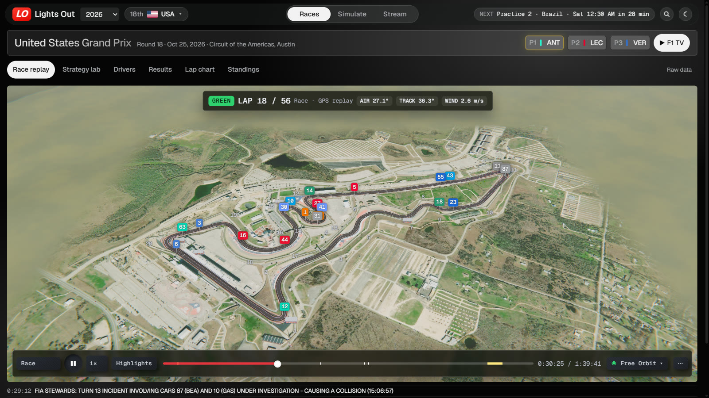
</p>

- **Real circuits in 3D** (three.js): real heights and banking from OpenF1 elevation, real track width, kerbs, run-off, Armco or concrete barriers, trees, the Monaco tunnel, a pit lane traced from real GPS, and **satellite imagery** fitted to the circuit and draped on the terrain
- **Cinema-grade lighting:** HDRI skies with the sun aimed at their brightest point, cascaded sun shadows, a rubbered-in racing line that darkens as the session goes on, motion blur, bloom, heat haze, sparks and spray
- **Cars** in team colours with race numbers, built to each era's regulation dimensions; 2026+ cars use a detailed RB22 model up close
- **GPS replay (2023+):** real car positions from OpenF1 for every session (practice, qualifying, sprint and race), with real speed, rpm, gear, throttle, brake and DRS
- **Lap-timing replay (1996+):** cars move at each lap's real pace, exact at every lap line, starting from a two-column grid and passing side by side without overlapping
- **HUD:** radar, g-force circle, tyre temperatures and wear, ERS, DRS zones and a telemetry cluster (modelled from the car's path where no telemetry exists); **Cinematic** hides it all
- **Timing tower** with animated overtakes, gaps and intervals, purple/green/yellow sectors, tyres, pit stops and retirements
- **Procedural engine sound** per era (cylinder count, rev limit, turbo, MGU-K), with Doppler, gear-shift cuts and team radio
- Track status (green, yellow, SC, VSC, red, chequered), the race control feed and weather

**Six cameras:** Chase, T-Cam, Cockpit (with a working mirror and steering-wheel display), TV Chase, Helicopter and Free Orbit. Press `C` to step through them.

<table>
<tr>
<td width="50%">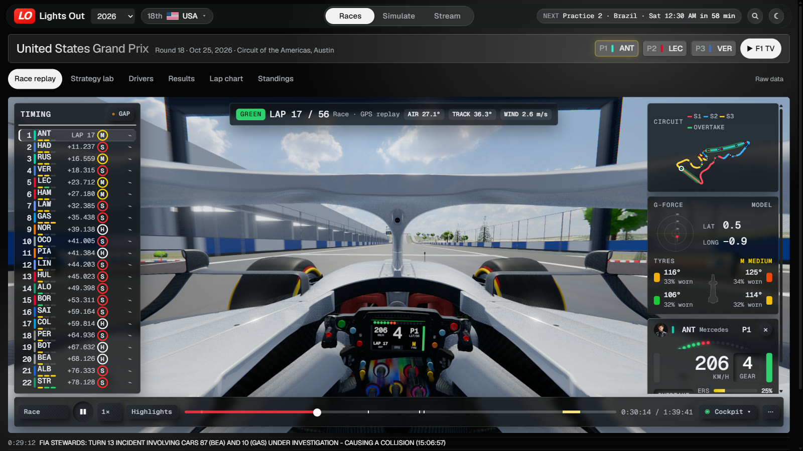</td>
<td width="50%">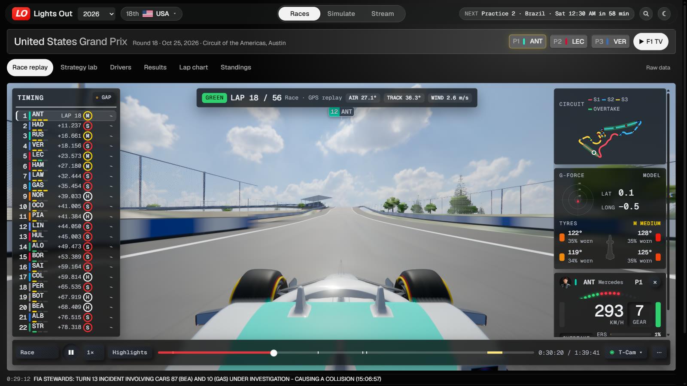</td>
</tr>
<tr>
<td align="center"><sub>Cockpit: halo, mirrors and a working steering-wheel display</sub></td>
<td align="center"><sub>T-Cam above the leader at 207 km/h</sub></td>
</tr>
</table>

### 🔴 Live sessions (free)

- **● LIVE** in the header (or **Latest session** between sessions) opens the current session in the same 3D view
- Live timing tower (positions, gaps, best laps, tyres, pits, speed trap), track status, race control, weather and the session clock, refreshed every second
- Without F1 TV, cars are placed from the mini-sectors they have completed and glide between them at their lap pace
- [With F1 TV connected](#-f1-tv), cars move on real live GPS and the focused car shows its real telemetry
- Picking a session that's running right now opens it live

### 🕹️ Simulate: a physics race on any circuit, in any era

The **Simulate** view runs a full physics race on the real circuit, with a grid from the real results, qualifying or standings. Watch the AI race, call the strategy from the pit wall, or take the wheel yourself.

<p align="center">
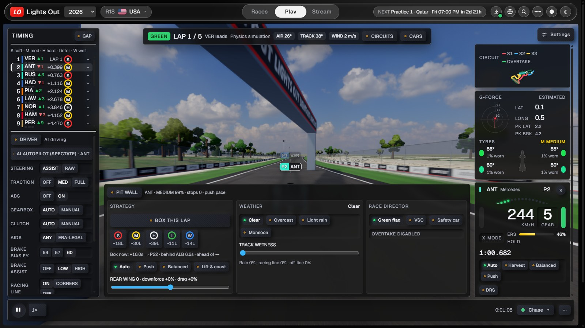
</p>

- **Era-accurate cars, 1950 to 2026+:** wings, skirts, flat floors, ground effect and 2026 active aero; bias-ply, slick and grooved tyres; H-pattern, semi-automatic and seamless gearboxes; turbo lag, MGU-H, MGU-K and the 2026 energy rules. Calibrated so a qualifying lap lands within about 4 % of real pole times at Austin, Monaco, Monza and Silverstone, from 1955 to 2026
- **Physics:** friction-circle braking, drag, downforce, porpoising, tow and dirty air, five tyre compounds with thermal windows and a wear cliff, ERS modes, DRS and overtake detection, weather and standing water
- **Pit wall:** box this lap, tyre choice with a pit-loss and rejoin predictor, pace modes, rear-wing trim, weather from clear to monsoon, and a race director for VSC and safety car
- **Take control** of any car with a keyboard or gamepad: speed-sensitive steering, traction control, ABS and braking assists, auto or manual gears and clutch, only the aids that era allowed if you want it real
- **AI racecraft:** tow, attack, one-move defence, leaving the space, contact and wing damage

<table>
<tr>
<td width="50%">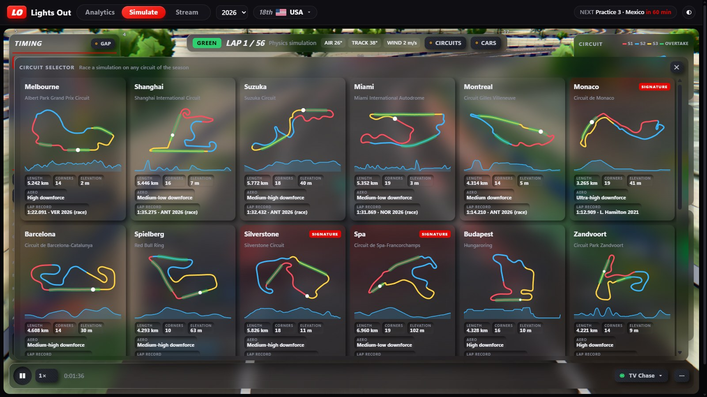</td>
<td width="50%">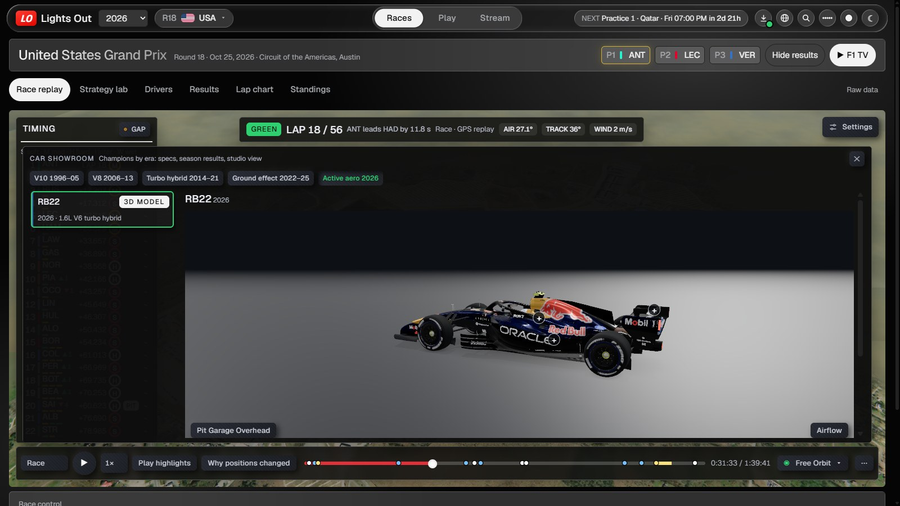</td>
</tr>
<tr>
<td align="center"><sub><b>CIRCUITS:</b> sectors, DRS zones, elevation and lap records; one click starts a race there</sub></td>
<td align="center"><sub><b>CARS:</b> each era's champions with specs, results and a 360° preview; <b>Race this era</b></sub></td>
</tr>
</table>

**Telemetry trace (`T`):** speed, throttle, brake, rpm and gear for any two cars against track distance, with Δt, sector zoom, a saved reference lap that outlives the race (compare eras!), CSV/JSON export, and a race engineer that tells you where the time went.

<p align="center">
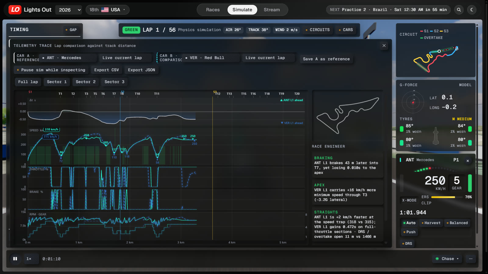
</p>

### 📊 Analytics

Everything about the race you're looking at, one tab away.

<p align="center">
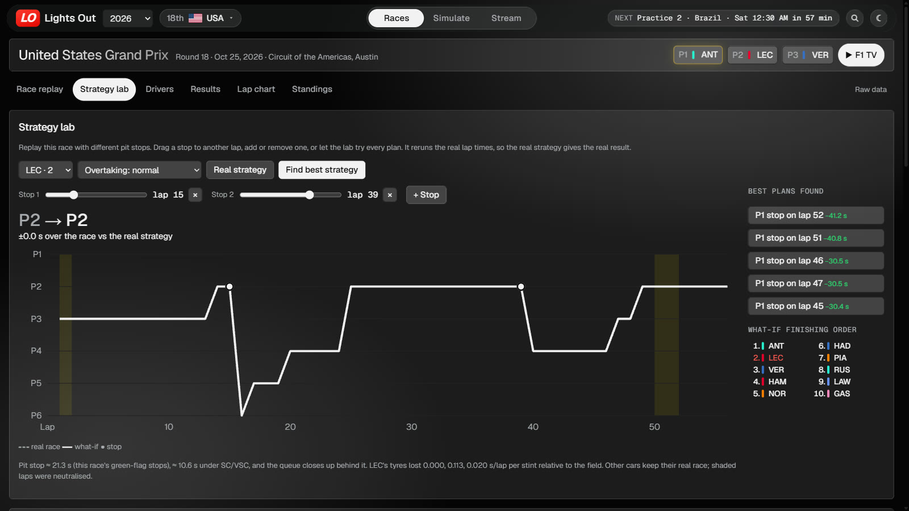
</p>

**🧪 Strategy lab:** drag a driver's pit stops to other laps, add or remove one, and see where they would have finished, lap by lap against the real race. **Find best strategy** tries every 1 to 3 stop plan in parallel. The model replays the real lap times, measures this race's pit loss, squeezes the gaps under safety cars like real life, and reproduces the real result exactly when nothing changes.

<table>
<tr>
<td width="50%">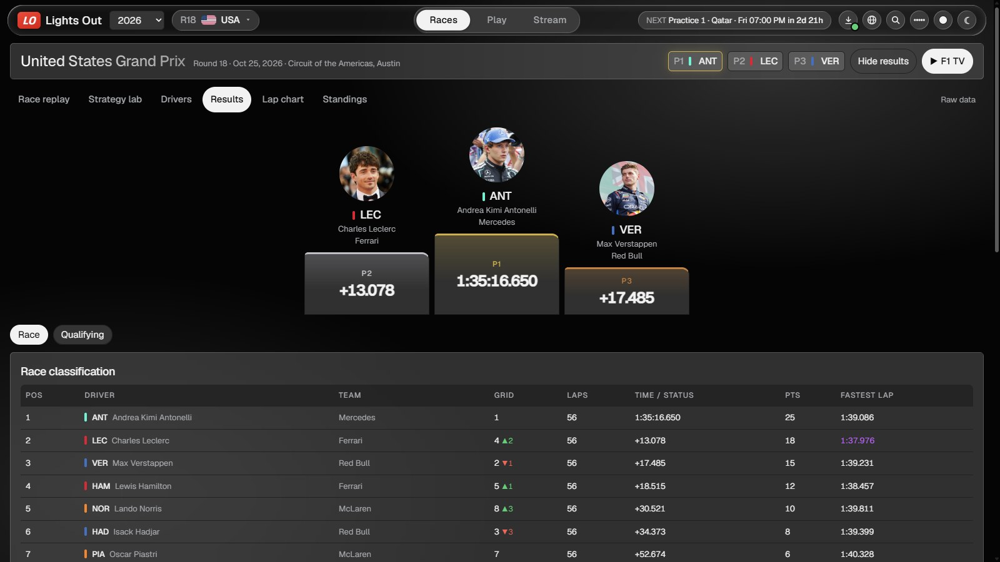</td>
<td width="50%">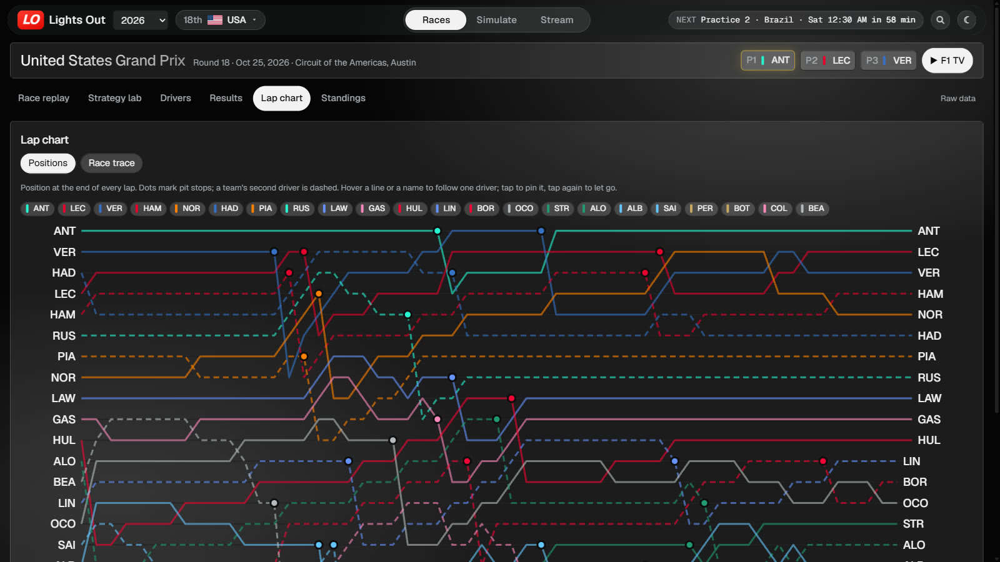</td>
</tr>
<tr>
<td align="center"><sub><b>Results:</b> podium, grid gains and losses, fastest lap, qualifying</sub></td>
<td align="center"><sub><b>Lap chart:</b> every position on every lap, pit stops marked; hover to follow a driver</sub></td>
</tr>
<tr>
<td width="50%">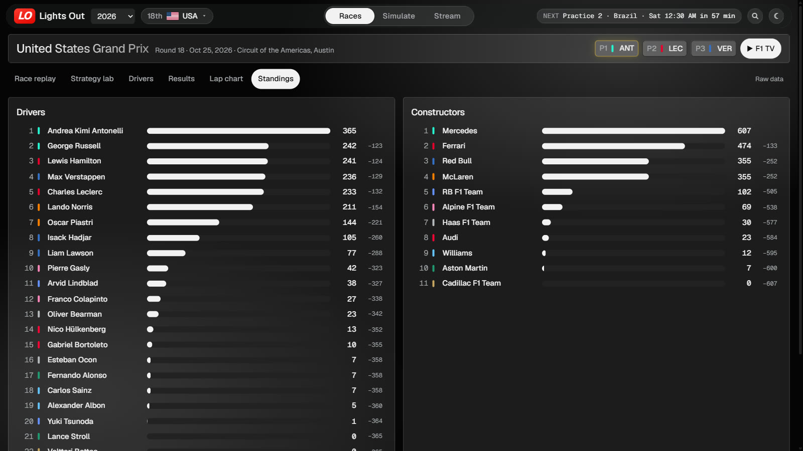</td>
<td width="50%">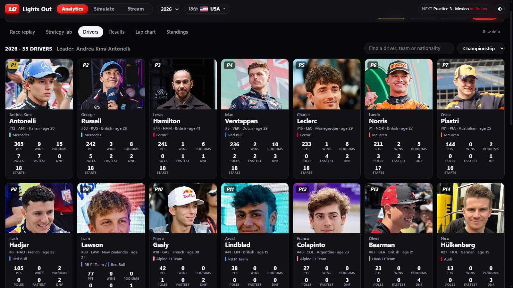</td>
</tr>
<tr>
<td align="center"><sub><b>Standings:</b> drivers and constructors after each round</sub></td>
<td align="center"><sub><b>Drivers:</b> season tallies; a card opens a driver's whole career</sub></td>
</tr>
</table>

- **Season calendar** with flags; the next race is highlighted and the header counts down to the next session
- **Raw data:** every Jolpica, OpenF1 and live-timing table, filterable, with CSV download

<p align="center">
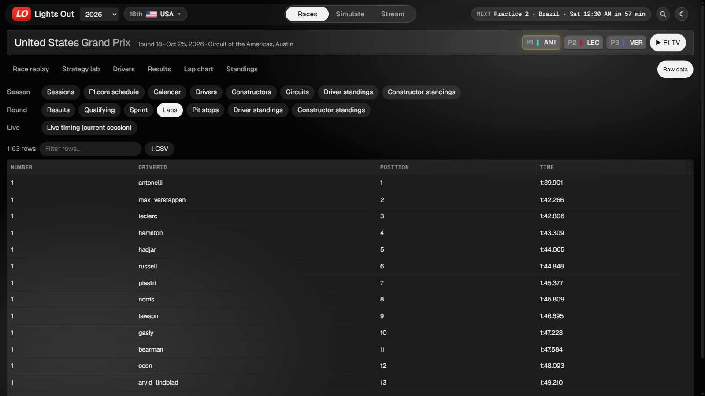
</p>

### 📺 Stream: 4K HDR multiview for your F1 TV

With your own F1 TV subscription, **Stream** turns into a TV-app browse page for the season and a broadcaster-grade multiview player: the race in **4K HDR**, every driver's onboard, live data over the picture and transcribed team radio, as many streams side by side as your screen and connection can take.

> **📺 4K or 1080p?** Watch **past races from 2025 onwards in 4K HDR**. **Live sessions play in 1080p**: F1 TV sends its live 4K only to Apple devices, encrypted with Apple's FairPlay DRM, which browsers on Windows can't decrypt. So on Windows a live session tops out at 1080p. Once F1 TV re-publishes the session as a replay (it can take a day or more), you can watch it in 4K.

> [!NOTE]
> **About these screenshots:** F1 TV's video can't be shown in a public README, so this section shows a simulated session. The viewer's real code is running with sample channel data, Lights Out's own 3D renders stand in for each video feed, and the radio messages are sample text. Everything around the pictures is the real interface: the layouts, menus, 4K badges, data overlays and radio list.

#### 🎞️ 4K HDR, on by default

<p align="center">
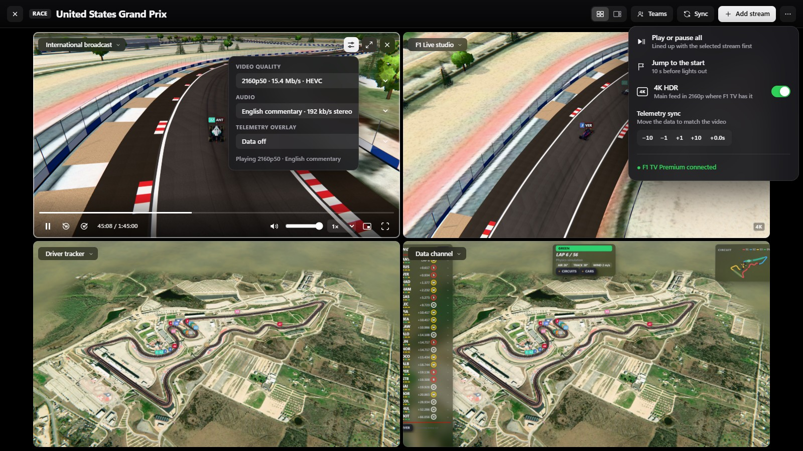
</p>

- **2160p50 HDR** (HEVC Main10, about 15.4 Mb/s) on the International broadcast and F1 Live of 2025+ races, with a **4K** badge on every tile that's playing it
- **Highest quality from the first frame:** every tile starts on its top rendition and never steps down; a slow connection buffers instead of blurring. Pick **Auto** in a tile's ⚙ menu to fit it to the tile
- The ⚙ menu lists **every rendition** (resolution, frame rate, bitrate, codec) and says why when a feed is playing in HD (older races have no 4K)
- **Checks your device first:** the 4K switch turns itself off where the browser can't decode HEVC Main10 at 2160p50 (Firefox, or Chrome without GPU HEVC); Microsoft Edge and Chrome on a GPU that decodes HEVC 10-bit play it
- Built to run several at once: three 2160p50 streams plus an onboard ran with 0 to 0.1 % of frames dropped, at about 15 Mb/s of bandwidth per 4K stream
- 4K needs an F1 TV subscription that includes it (F1 TV Premium)
- **4K is for replays of 2025+ races.** Live sessions play in **1080p** on Windows: F1 TV's live 4K is FairPlay-encrypted for Apple devices only

#### 🧩 Any number of streams, laid out for you

Add as many streams as you like. Every tile stays a true 16:9 picture, as big as your window allows, and the layout reflows as you add, remove or resize.

<table>
<tr>
<td width="50%">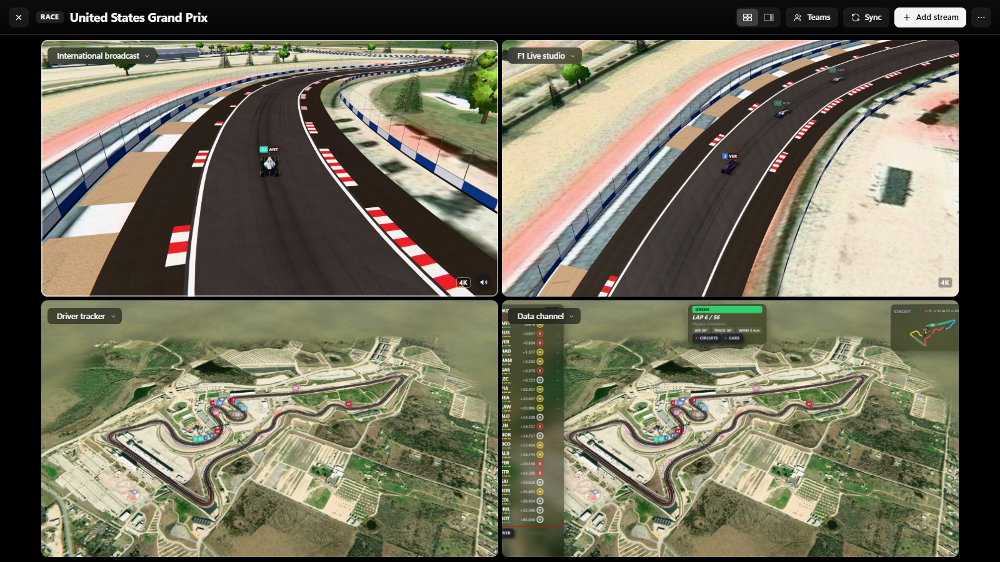</td>
<td width="50%">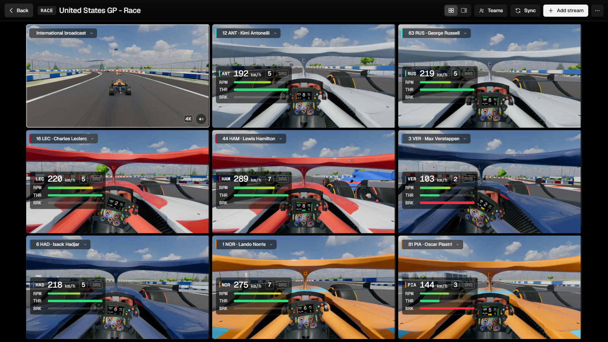</td>
</tr>
<tr>
<td align="center"><sub><b>Grid, 4 streams:</b> the race in 4K, F1 Live in 4K, the driver tracker and the data channel</sub></td>
<td align="center"><sub><b>Grid, 9 streams:</b> the race plus eight onboards, each with its own speed, gear, RPM, throttle and brake</sub></td>
</tr>
</table>

<p align="center">
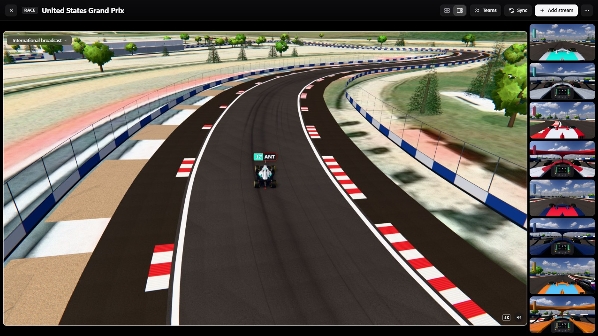
<br><sub><b>Focus:</b> the stream you're listening to big, the rest as thumbnails beside it (or under it in a tall window). Switch with one click, or press a tile's ⤢ to make it the big one</sub>
</p>

**How the grid arranges itself** (on a 16:9 screen; it picks the column count that gives the biggest pictures and centres a short last row):

| Streams | Grid layout | | Streams | Grid layout |
|:-:|:-:|---|:-:|:-:|
| 1 | full screen | | 6 | 3 + 3 |
| 2 | 2 side by side | | 7 | 3 + 3 + 1 |
| 3 | 2 + 1 | | 8 | 3 + 3 + 2 |
| 4 | 2 × 2 | | 9 | 3 × 3 |
| 5 | 3 + 2 | | 12 / 16 | 4 × 3 / 4 × 4 |

In **Focus** the selected stream takes most of the screen: about 75 % of the width with 2 others, about 90 % with 8.

#### 🏎️ Every driver's onboard, with live data

<p align="center">
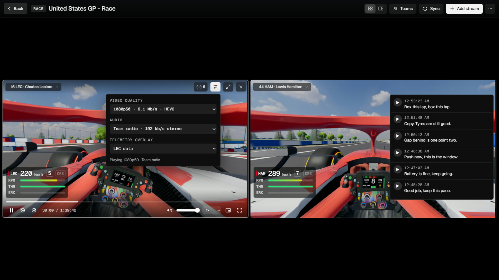
</p>

- **All 20+ drivers' onboard cameras**, each a tile of its own, in team colours with number and name
- **Live data on the picture:** speed, gear, RPM, throttle, brake and DRS from the car's telemetry (2023+), drawn see-through over the onboard and updated every half second
- **Synced to the video:** **Jump to the start** puts every tile 10 s before lights out, found in the car data; nudge the data ±1 s or ±10 s if a broadcast runs early or late, and the offset is remembered per video
- Onboards open on the **team radio** audio track; switch to track sound, or any commentary language, per tile

#### 📻 Team radio, transcribed on your computer

- Each onboard's **radio button** shows how many messages there are so far and opens a scrollable list: time, words, and ▶ to hear the original clip
- **No spoilers:** a replay's list only shows what's been said up to the playhead, so it grows as you watch
- **Words, not just clips:** F1 publishes radio as audio only, so Lights Out transcribes every message on your own computer with [faster-whisper](https://github.com/SYSTRAN/faster-whisper) (about 0.5 s a clip on an NVIDIA GPU, 4.5 s on the CPU). Nothing is sent to a cloud service
- **Live too:** during a session, new messages appear about 30 s after they're said

#### 👥 Pick any stream, or a whole team

<table>
<tr>
<td width="50%">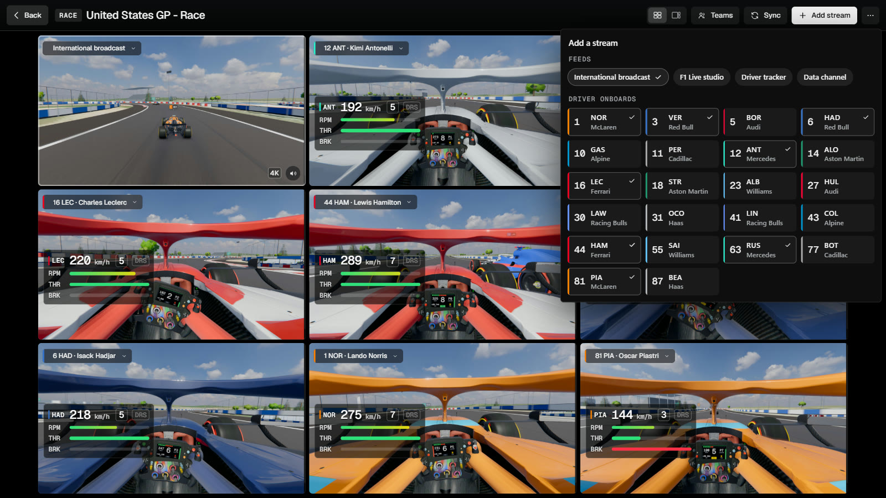</td>
<td width="50%">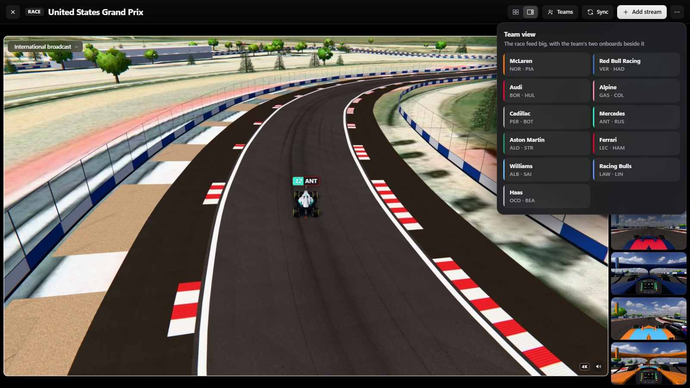</td>
</tr>
<tr>
<td align="center"><sub><b>Add stream:</b> every feed and every driver, ticked when already on screen; a tile's label switches that tile the same way</sub></td>
<td align="center"><sub><b>Teams:</b> one click for the race feed big with a team's two onboards beside it</sub></td>
</tr>
</table>

<p align="center">
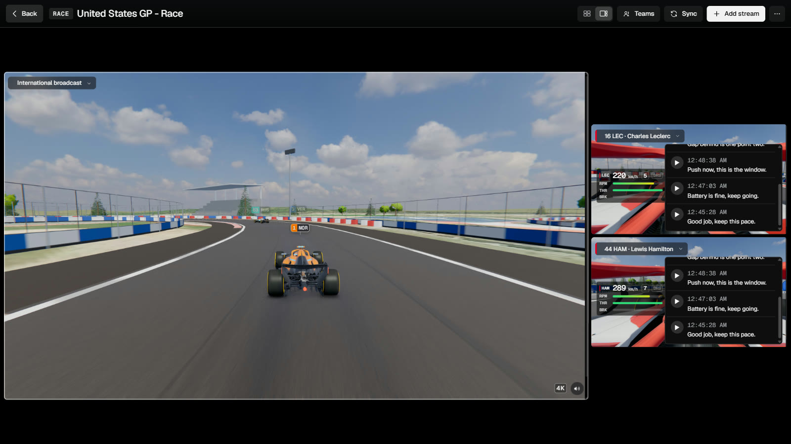
<br><sub><b>Team view, Ferrari:</b> the race in 4K, both onboards with their data and team radio</sub>
</p>

#### 🎛️ Every control you'd expect

| Where | What you get |
|-------|--------------|
| **Header** | Grid / Focus layout, **Teams**, **Sync** (line every stream up with the one you hear), **Add stream**, and **More**: play or pause all, jump to the start, the 4K HDR switch, telemetry sync and your account |
| **Each tile** | A team-colour label that switches the stream, 📻 team radio, ⚙ quality / audio / data overlay, ⤢ focus, ✕ remove; the tile you hear has a white ring, and a click moves the sound to another |
| **Control bar** | Seek with the buffered range shown, ±10 s, volume, speed 0.5× to 2×, captions, picture-in-picture, fullscreen of one tile with its overlays |
| **Audio** | Every commentary language F1 TV carries, track sound without commentary, and team radio, each 192 kb/s stereo |
| **Keyboard** | `K` / `Space` play or pause · `←` `→` 10 s · `M` mute · `F` fullscreen tile |
| **Continue watching** | Close a replay and pick it up later where you left off, from Stream's first row |

The viewer is designed to stay out of the way: one line-icon set, no clutter, and each tile's controls only appear while your mouse moves over it. Opening it pauses the 3D replay behind it, so your GPU goes to the video.

#### 🗓️ Browse the season

Stream opens as a TV-app page for the season: a full-bleed billboard with the live session (else the latest race), **This weekend** chips for every session, **Continue watching**, **Coming up** with countdowns to each session, and a row per race weekend holding just its sessions, race first.

Without a subscription, Stream still shows the schedule with countdowns and opens each video on F1 TV's own site. Live streams use Widevine DRM and play in Chrome or Edge.

### 🖥️ A desktop app, too

<table>
<tr>
<td width="40%">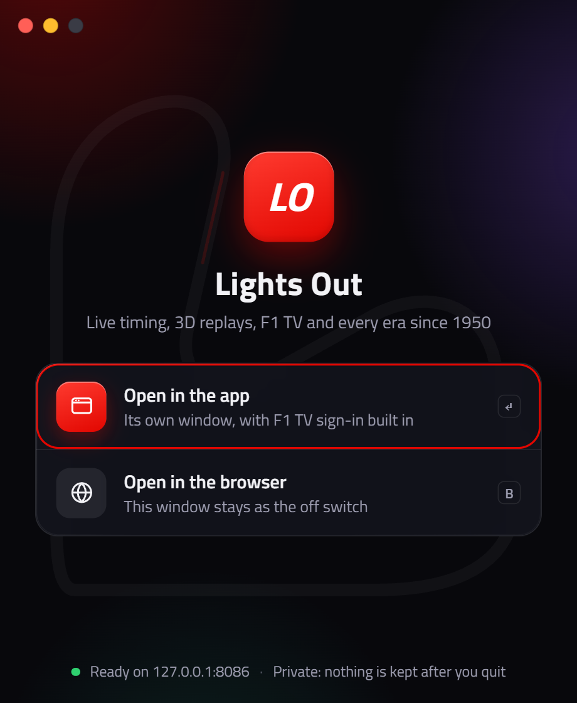</td>
<td valign="middle">

Prefer an app to a browser tab? The desktop launcher opens Lights Out in **its own window** (with F1 TV sign-in built in) or **in your browser**. It's private by default: nothing is kept after you quit.

Windows users can [download the exe](#%EF%B8%8F-desktop-app-and-executable): unzip and run, no Python needed.

</td>
</tr>
</table>

---

## 🚀 Quick start

> [!IMPORTANT]
> Needs **Python 3.14+** and **[uv](https://docs.astral.sh/uv/)**. [Node.js](https://nodejs.org) is only needed to run the frontend tests.

```bash
git clone https://github.com/adityavar95/lights-out.git F1
cd F1
uv sync
uv run python src/server.py
```

Open **http://127.0.0.1:8086**. Other devices on the same network can open **http://&lt;this-computer-ip&gt;:8086** (the server prints the address). If Windows Firewall asks, allow access on private networks.

> [!NOTE]
> On start-up the server builds the GPS replays of the season's last 3 races in the background. The first replay of any other GPS session downloads every car's trace from OpenF1 (20–60 s); the lap-timing replay plays meanwhile and the GPS replay takes over when it's ready. Finished sessions are cached in `.cache/replay/`.

> [!TIP]
> Radio transcription runs on an NVIDIA GPU when CUDA loads (~0.5 s a clip), else on the CPU (~4.5 s). The whisper model (`small.en`) downloads on first use.

## 🖥️ Desktop app and executable

Run Lights Out in its own window instead of a browser tab:

```bash
uv run python src/desktop.py
```

A small launcher asks **Open in the app** or **Open in the browser**. The app window uses the system's WebView2 (pywebview), so nothing else needs installing. In the browser, the launcher stays open: close it to stop Lights Out. If `src/server.py` is already running, the launcher uses it; set `LIGHTSOUT_PORT` to run on a port other than 8086.

**Download the Windows executable:** get `LightsOut-windows-x64.zip` from the repo's [Releases](https://github.com/adityavar95/lights-out/releases), unzip it anywhere and run `LightsOut\LightsOut.exe`. No Python needed. Windows SmartScreen may warn about an unsigned app: **More info → Run anyway**.

<details>
<summary><b>Build the Windows executable yourself</b></summary>

On Windows 10/11, with the Quick start prerequisites:

1. Install the dependencies. `uv sync` also installs the dev group, which has PyInstaller:

   ```bash
   uv sync
   ```

2. Build it (a few minutes):

   ```bash
   uv run python scripts/build_exe.py
   ```

   This produces the folder `dist/LightsOut/`, with `LightsOut.exe` inside it. PyInstaller's working files go in `build/`. Both folders are git-ignored, and each build replaces the last.

3. Try it:

   ```bash
   dist/LightsOut/LightsOut.exe
   ```

4. Zip the whole folder to share it (about 450 MB unzipped). The exe needs the `_internal` folder beside it, so share the folder, not the exe alone:

   ```powershell
   Compress-Archive -Path dist\LightsOut -DestinationPath dist\LightsOut-windows-x64.zip -Force
   ```

5. Optional: publish it as a GitHub release with the [GitHub CLI](https://cli.github.com):

   ```bash
   gh release create v0.1.0 dist/LightsOut-windows-x64.zip --title "Lights Out v0.1.0" --notes "Windows build"
   ```

The exe keeps its cache in `LightsOut/.cache` and its log in `LightsOut/lightsout.log`, beside itself. If it doesn't open, look in that log.

> [!NOTE]
> The exe leaves out NVIDIA's 2 GB of CUDA libraries, so radio transcription runs on the CPU there. Remove `--exclude-module nvidia` in `scripts/build_exe.py` to include them.

</details>

## 📺 F1 TV

Lights Out plays F1 TV with **your own subscription**, the way [MultiViewer](https://multiviewer.app) does: you sign in on F1's own site, your password never reaches the app, and nothing is stored on the server. Lights Out doesn't sell, share or unlock any video: it is a player for what you already pay F1 for.

| Where | How to connect |
|-------|----------------|
| **Desktop app** | **Connect F1 TV → Sign in to F1 TV**: F1's sign-in opens in a window of its own and closes once you're signed in |
| **Browser** | **Connect F1 TV**, drag the bookmarklet to your bookmarks bar, sign in at formula1.com, then click the bookmarklet there: it brings you back connected |

The connection lasts until you close the tab or the app. Without F1 TV connected, Stream's cards open the video on f1tv.formula1.com.

> [!WARNING]
> Use email and password: Google sign-in doesn't work inside the desktop app's window. Replays play without DRM; live streams use Widevine, which the desktop app's WebView2 isn't officially supported for.

## ⌨️ Controls

| Where | Keys |
|-------|------|
| Replay | `Space` play/pause · `←` `→` seek 10 s · `C` next camera · `T` telemetry trace · click a driver to follow them |
| Driving | `W`/`↑` throttle · `S`/`↓` brake · `A` `D`/`←` `→` steer · `E`/`Shift` gear up · `Q`/`Ctrl` gear down · `X` clutch · `R`/`Space` DRS · `F` overtake · `P` pit · `C` camera · gamepads work too |
| F1 TV viewer | `K`/`Space` play/pause · `←` `→` ±10 s · `M` mute · `F` fullscreen tile |

## 🔌 API

Lights Out's backend is an open JSON API, so you can build your own tools on it. Table endpoints return `{"columns": [...], "data": [[...]], "total": n}`, capped at 5,000 rows. Interactive docs are at **http://127.0.0.1:8086/docs**.

<details>
<summary><b>All endpoints</b></summary>

| Endpoint | Returns |
|----------|---------|
| `GET /api/seasons` | Available seasons |
| `GET /api/season/{year}` | The season's sessions |
| `GET /api/season/{year}/f1schedule` | Schedule from formula1.com |
| `GET /api/jolpica/{year}/{kind}` | Season data: `races`, `drivers`, `constructors`, `circuits`, `driverstandings`, `constructorstandings` |
| `GET /api/jolpica/{year}/{kind}?round={n}` | Round data: `results`, `qualifying`, `sprint`, `laps`, `pitstops`, standings |
| `GET /api/driver/{driverId}` | A driver's career: every result and season standing |
| `GET /api/track/{year}/{round}` | Circuit outline with corners, width and pit loss |
| `GET /api/geo/{year}/{round}` | The circuit's real outline in metres (for satellite imagery) |
| `GET /api/elevation/{year}/{round}` | Track heights along a lap (2023+) |
| `GET /api/pitlane/{year}/{round}` | The pit lane's path from GPS |
| `GET /api/circuit/{circuitId}` | The latest past race at a circuit |
| `GET /api/replay/{year}/{round}?session=Race` | Replay data (`mode: "gps"` or `"laps"`; `&laps=1` forces lap timing) |
| `GET /api/telemetry/{year}/{round}?driver={n}&session=Race` | One car's speed, rpm, gear, throttle, brake, DRS (2023+) |
| `GET /api/live` | Live (or latest) session state from F1's live timing |
| `GET /api/live/track` | Outline and mini-sectors of the live session's circuit |
| `GET /api/live/table/{topic}` | One live topic (e.g. `TimingData`) as a table |
| `GET /api/f1tv/{year}/{round}` | The weekend's F1 TV videos |
| `GET /api/f1tv/account` | Whether the connected token is a live subscription (never the token) |
| `GET /api/f1tv/channels/{id}` | A video's feeds and driver onboards |
| `GET /api/f1tv/play/{id}?channel=` | A signed stream manifest (needs `X-F1-Token`) |
| `POST /api/f1tv/license` | Widevine licence relay for live streams |
| `GET /api/f1tv/telemetry/{year}/{round}/{driver}?session=` | A whole session's telemetry for the viewer's overlay |
| `GET /api/f1tv/radio/{year}/{round}/{driver}?session=` | Team radio clips with transcripts |
| `GET /api/f1tv/radio/audio?u=` | One radio clip's audio |
| `POST /api/count/{event}` · `GET /api/counts` | Anonymous per-day usage totals (see [Privacy](#-privacy)) |

F1 TV endpoints take your subscription token in the `X-F1-Token` header.

</details>

## 📁 Project structure

<details>
<summary><b>Show the tree</b></summary>

```
F1/
├── src/
│   ├── server.py        # FastAPI routes, start-up warm-up, usage counts
│   ├── desktop.py       # Desktop launcher: app window or browser, in-app F1 TV sign-in
│   ├── jolpica.py       # Jolpica queries, paging, disk cache for settled races
│   ├── replay.py        # Replays (OpenF1 GPS or Jolpica lap timing), telemetry, elevation, pit lane
│   ├── tracks.py        # Circuit outlines: MultiViewer, OpenF1 lap, GeoJSON fallback
│   ├── live.py          # Free live timing over F1's SignalR Core feed
│   ├── f1tv.py          # F1 TV catalogue, channels, play and licence
│   ├── f1auth.py        # F1 TV token expiry check
│   ├── radio.py         # Team radio clips and faster-whisper transcription
│   └── static/          # Frontend: vanilla JS modules, no build step
│       ├── index.html, launcher.html, style.css, circuitdeck.css
│       ├── app.js            # Analytics / Simulate / Stream, calendar, hero, tabs
│       ├── replay.js         # Replay engine (GPS, lap timing, live)
│       ├── scene3d.js        # three.js scene, cameras, shadows, ground
│       ├── circuit3d.js, track3d.js, cars3d.js, rb22.js, post.js, vfx.js, mirror.js
│       ├── satellite.js, groundwork.js   # satellite imagery fitted in a worker
│       ├── sim.js, vehicle.js, eras.js, simmode.js, player.js, racecraft.js,
│       │   tyres.js, weather.js, racecontrol.js, strategy.js, track.js, circuits.js   # race simulation
│       ├── hud.js, tower.js, onboard.js, pitwall.js, driverdeck.js, decks.js
│       ├── circuitdeck.js, carsdeck.js, trace.js, tracechart.js, tracemodal.js
│       ├── audio.js, audiodeck.js       # procedural engine sound
│       ├── stream.js, multiviewer.js, tvcontrols.js   # F1 TV
│       ├── whatif.js, strategylab.js, optimiser.js    # Strategy lab
│       ├── drivers.js, charts.js, explorer.js, live.js, lanes.js
│       ├── focus.js, telemetry.js, input.js, util.js
│       └── models/           # rb22.glb and its credits
├── scripts/build_exe.py # PyInstaller build of LightsOut.exe
├── tests/               # test_server.py and the Node .mjs tests
├── docs/screenshots/    # the screenshots in this README
├── docs/media/          # the trailer (mp4) and its poster
└── pyproject.toml
```

</details>

## 🧪 Tests

Plain asserts, no test framework:

```bash
uv run python tests/test_server.py   # backend
node tests/test_live.mjs              # live car placement
node tests/test_telemetry.mjs         # HUD telemetry (g-forces, tyres, ERS, DRS)
node tests/test_sim.mjs               # race physics
node tests/test_player.mjs            # player driving and AI racecraft
node tests/test_eras.mjs              # era profiles and lap times by era
node tests/test_circuits.mjs          # aero trim, grade, banking
node tests/test_trace.mjs             # telemetry trace and engineer insights
node tests/test_whatif.mjs            # Strategy lab model
node tests/test_multiviewer.mjs       # F1 TV overlay timing
node tests/test_lanes.mjs             # lap-timing replay lanes
node tests/test_drivers.mjs           # Drivers tab tallies
```

## 🤝 Contributing

Lights Out gets better every time a fan adds something they wish it had. You don't need to be an expert, and every kind of help counts:

- **🐛 Report a bug:** open an [issue](https://github.com/adityavar95/lights-out/issues) with the race, session and what you saw (a screenshot helps)
- **💡 Suggest a feature:** a circuit preset, a new chart, a camera angle, a better strategy model
- **🏁 Add circuit detail:** banking, kerbs, barriers and DRS zones live in `src/static/circuits.js` `PRESETS`, and every circuit added makes the replays and the simulator better
- **🏎️ Tune an era:** the cars of every season since 1950 are in `src/static/eras.js`; if you know how a 1970s Cosworth or a 2004 V10 should feel, help calibrate it
- **🌐 Spread the word:** star the repo, share a screenshot of your favourite race, tell a friend who loves the sport

**Pull requests:**

1. Fork the repo and create a branch
2. Keep to the house style: vanilla JS modules with no build step, small pure functions where physics or maths is involved
3. Add or update a test in `tests/` for new logic (plain asserts, see [Tests](#-tests)) and run them
4. Open a PR describing what changed and why, with a screenshot for anything visual

Be kind and constructive: this is a hobby project made by and for people who love racing.

## 🗂️ Data sources

Lights Out stands on the shoulders of open, community-run projects.

| Source | Used for |
|--------|----------|
| [Jolpica F1](https://github.com/jolpica/jolpica-f1) | Results, qualifying, sprints, lap times, pit stops, standings, calendar, careers |
| [OpenF1](https://openf1.org) | Car GPS, telemetry, elevation, intervals, laps, tyres, pits, race control, weather, team radio (2023+) |
| F1 live timing (SignalR Core) | Live sessions: timing, tyres, track status, race control, weather, team radio |
| [F1 TV](https://f1tv.formula1.com) | Video, with your own subscription |
| [livef1](https://github.com/GoktugOcal/LiveF1) | Seasons, sessions and its bundled Jolpica client |
| [MultiViewer](https://multiviewer.app) API | Circuit outlines, corners, mini-sectors, pit loss |
| [bacinger/f1-circuits](https://github.com/bacinger/f1-circuits) | GeoJSON outlines for circuits MultiViewer doesn't cover |
| [Esri World Imagery](https://www.arcgis.com/home/item.html?id=10df2279f9684e4a9f6a7f08febac2a9) | Satellite ground under each circuit |
| [Poly Haven](https://polyhaven.com) | HDRI skies |
| [Wikipedia](https://www.wikipedia.org) | Driver portraits and biographies |
| [flagcdn](https://flagcdn.com) | Country flags |

Please respect each source's own terms and rate limits; Lights Out caches what it can so it asks them as little as possible.

## ⚠️ Limitations

- **Live GPS and live video need F1 TV.** Without a token, live cars are placed per mini-sector (about 20 per lap) and cars in the pits leave the track.
- **OpenF1 is locked while any session is live.** Cached GPS replays still open, race replays fall back to lap timing, and the session list comes from livef1. GPS replays of a session appear once OpenF1 publishes it, usually shortly after it ends.
- **OpenF1's free tier allows ~30 requests a minute**, and a GPS replay costs ~30, so building several at once queues them.
- **F1 TV blocks an IP after a few hundred catalogue searches**; Stream fetches three weekends at a time to stay under it.
- **4K needs 2025+ races**, the main feeds, and a device that decodes HEVC Main10 2160p (not Firefox, nor Chrome without GPU HEVC).
- **Live sessions play in 1080p on Windows.** F1 TV only sends live 4K to Apple devices, as FairPlay-encrypted HLS, which Windows browsers and the desktop app can't decrypt. For 4K, watch the replay once F1 TV re-publishes it (it can take a day or more).
- Lap-timing replays (before 2023) are exact only at the start/finish line. Races before 1996 have no lap data and no replay, though you can still simulate them.
- Track maps use each circuit's modern layout, so historic races on since-changed layouts show today's track. GeoJSON outlines have no known start line or direction.
- livef1 can't build some seasons (2010 fails inside livef1); the rest of the app still works for those years.
- Tables over 5,000 rows are truncated in the data explorer.

## 🔒 Privacy

Lights Out runs on your computer and keeps what's yours on it.

- Your F1 TV token stays in the browser tab (sessionStorage) or the desktop app's private window, and is sent only with this app's own requests. The server keeps no token or password.
- Usage counts are anonymous per-day totals of a fixed list of events in `.cache/counts.json` on your own machine: no id, cookie, IP or URL. Nothing is sent under Do Not Track or Global Privacy Control.
- No ads, no third-party analytics, no account.

## 📜 License

Lights Out is open source under the [MIT License](LICENSE): free to use, copy, modify and share, for anyone.

The 2026 car model is "2026 Redbull RB22" by Tyler_Dave, licensed [CC BY 4.0](http://creativecommons.org/licenses/by/4.0/) (see [`src/static/models/CREDITS.md`](src/static/models/CREDITS.md)). Data, imagery and video come from the [sources above](#%EF%B8%8F-data-sources) under their own terms. Driver portraits in the screenshots are loaded from Wikipedia and belong to their photographers.

## 🏳️ Disclaimer

Lights Out is an unofficial, independent fan project. It is not associated in any way with the Formula 1 companies, F1 TV, the FIA, or any team or driver. F1, FORMULA ONE, FORMULA 1, FIA FORMULA ONE WORLD CHAMPIONSHIP, GRAND PRIX and related marks are trademarks of Formula One Licensing B.V. Team names and liveries are used only to identify real teams. F1 TV content requires your own subscription.

## 🙏 Acknowledgements

Huge thanks to the people behind Jolpica, OpenF1, livef1, MultiViewer, f1-circuits, Poly Haven, shaka-player, three.js and faster-whisper. Their open work is what makes a free project like this possible.

Trailer music: "Happy Beats / Business Moves Vol. 11" by Sascha Ende, [ende.app](https://ende.app/en) ([CC BY 4.0](https://creativecommons.org/licenses/by/4.0/)). Sound effects: [Kenney](https://kenney.nl/) (CC0).

<div align="center">

<br>

**Made with ❤️ by fans, for fans. If Lights Out made a race more fun, give it a ⭐ and share it with someone who loves the sport.**

<sub>It's lights out and away we go. 🏁</sub>

</div>
